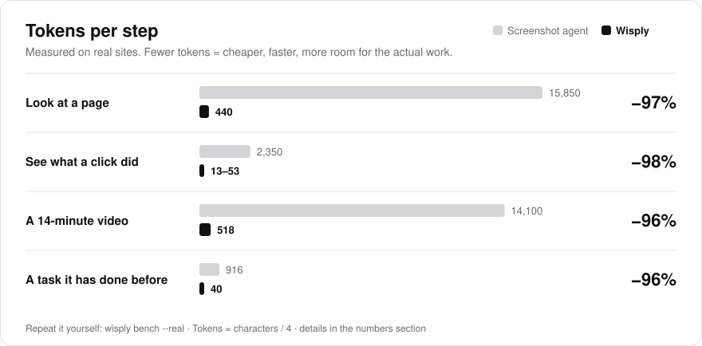
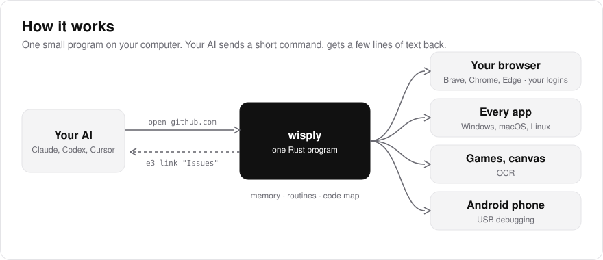

<p align="center">
  
</p>

<h1 align="center">Wisply</h1>

<p align="center">
  <b>Your AI uses your real browser and every app on your computer,<br>with a few lines of text instead of screenshots.</b>
</p>

<p align="center">
  <a href="https://github.com/QDHShamiro/Wisply/releases/latest"></a>
  
  
  
  
</p>

<p align="center">
  <a href="#what-you-need">What you need</a> ·
  <a href="#quick-start">Quick start</a> ·
  <a href="#what-it-does">What it does</a> ·
  <a href="#how-it-works">How it works</a> ·
  <a href="#the-numbers">Numbers</a> ·
  <a href="#commands">Commands</a> ·
  <a href="#safety">Safety</a>
</p>

<picture>
  <source media="(prefers-color-scheme: dark)" srcset="docs/compare-dark.svg">
  
</picture>

## In one minute

AI agents usually look at a website by taking screenshots and reading the whole page. That costs thousands of
tokens per step, and the agent drives a fresh browser that is logged out of everything.

Wisply gives your AI **your** browser (with your logins) and your desktop apps as short text: what is on the screen,
what can be clicked, and one line after every click saying what changed. It runs on your computer, in the
background, and closes what it opened when the AI is done.

```
$ wisply open github.com/QDHShamiro/Wisply -f "Issues|Pull requests"
[t1] QDHShamiro/Wisply - github.com/QDHShamiro/Wisply
e3 link "Issues" ->./issues
e4 link "Pull requests" ->./pulls
$ wisply click "Issues"
ok e3 -> github.com/QDHShamiro/Wisply/issues
```

## What you need

| | |
|---|---|
| 💻 **A computer** | Windows 10/11, macOS or Linux |
| 🌐 **A browser** | Brave, Chrome or Edge (Firefox does not work) |
| 🤖 **An AI app** | Claude Code, Codex, Cursor, VS Code, Claude Desktop or any other MCP client |

Nothing else. No Python, no Node, no account. Wisply is one program.

## Quick start

In Claude Code:

```
/plugin marketplace add QDHShamiro/Wisply
/plugin install wisply@wisply
/wisply:setup
```

Setup loads the browser extension by itself, runs a self-test and tells Claude Code to use Wisply. Then just ask:
*"open my GitHub notifications and summarize them"*.

Other apps (Codex, Cursor, Gemini CLI, VS Code, Claude Desktop, LM Studio, Cline, Roo Code, Zed, Windsurf,
Antigravity): [Install](#install).

## What it does

| | |
|---|---|
| 🌐 **Your real browser** | All your logins, through a small extension. Wisply's tabs live in their own window and tab group, in the background. |
| 🖥️ **Every app** | Reads normal apps through the accessibility tree, games and canvas apps through OCR. On Windows clicks and typing reach the app in the background; your mouse stays where it is. |
| 📱 **Your Android phone** | `phone snap` shows the screen as text, `phone tap p3` taps, over USB debugging. |
| 🧠 **Learns your tasks** | Do something twice and it becomes a routine that runs in one call. |
| 💾 **Remembers** | A memory on your computer: decisions, to-dos and what happened in earlier sessions, ~500 tokens at the start of each session. |
| 🎞️ **Watches videos** | Chapters, speech, the text on screen and 12 scenes in one image. |
| 🔍 **Thinks without AI** | `wisply think` checks code, web, texts and images with rules that fit the project and your own CLAUDE.md rules, fixes what is safe, proves it with your build and keeps a blind A/B for you. |
| 🧹 **Cleans up** | When the AI finishes its reply, what it opened closes again and your window comes back. |
| 🔒 **Safe by default** | Banking sites are read-only, buy/pay/delete buttons need `--yes`, hidden page text never reaches the model. |

## How it works

<picture>
  <source media="(prefers-color-scheme: dark)" srcset="docs/how-dark.svg">
  
</picture>

- **Refs instead of pixels.** Everything clickable gets a short name (`e12` on a page, `d5` in an app, `t4` a tab,
  `w2` a window). Only visible, usable elements are listed; page headers and 60-link footers collapse to one line.
- **One call instead of many.** `open <url> -f "words"` returns only matching lines,
  `do "fill Email=a@b.c; click Continue; expect Welcome"` runs a whole sequence, a known task is `run <name>`.
- **Errors name the next step.** `err: nothing matches "Log in" -> try: wisply snap -f "log in"`.
- **Never in your way.** No window jumps to the front, not even over a full-screen game. Each AI session gets its
  own browser window, so parallel sessions never mix.

### The second time is one call

Wisply keeps a trace of each task. When a task repeats, it lines the runs up and turns the parts that differ into
parameters:

```
run 1   launch spotify:search:SOS    → snap → click "SOS wiedergeben"
run 2   launch spotify:search:Numb   → snap → click "Numb wiedergeben"
        ! learned routine spotify-wiedergeben from 2 runs
run 3   wisply run spotify-wiedergeben search=SOS
        ok spotify-wiedergeben: 2 steps in 1.4 s, verified
```

Routines check their result, repair themselves when a step breaks, and keep score (runs, success rate, tokens
saved). You can also show it once: `wisply record start`, do it yourself, `wisply record stop`.

### It remembers

```
you      merk dir, dass Brave der einzige Browser ist
         Wisply memory saved #14905: "Brave der einzige Browser ist"
claude   wisply recall "game pause"
         #13529 10-18 feature: Pause Mode Detection …
```

When a session ends, a local model (downloaded by Wisply, never run while you play a game) keeps its decisions,
fixes and open points. Search works by words and meaning, in any language. Everything stays in one SQLite file in
`~/.wisply/memory`; keys and passwords are cut out before anything is stored.

### Images and video

<p align="center">
  
  <br><sub><code>wisply frames e1</code> on a 5-second CC0 clip: 6 moments in one image, ~518 tokens, 0.9 s.</sub>
</p>

`watch <link|file>` gives an overview of any video (chapters, speech, screen text, scenes), `frames e40` turns a
video on the page into one contact sheet, `listen` returns only the speech, `shot e57` looks at one image.

## The numbers

Every number comes from a run you can repeat: `wisply bench`, `wisply bench --real`, `wisply selftest`.
Brave, Windows 11. Tokens are characters / 4.

| Action | Without Wisply | With Wisply | Saved |
|---|---:|---:|---:|
| Look at a page (GitHub repo) | ~15,850 (screenshot + page text) | **~440** (`open`) | **−97%** |
| See a 14-minute video | ~14,100 (6 screenshots, waiting while it plays) | **~518** (`frames`, 2.1 s) | **−96%** |
| See what a click did | ~2,350 (new screenshot) | **13–53** (one line) | **−98%** |
| Find one thing on a page | ~2,350 (screenshot) | **~36–50** (`snap -f`) | **−98%** |
| Do a known task again | ~916 (every step by hand) | **~40** (`run`, 1 call) | **−96%** |
| A screenshot, when you need one | ~2,350 | ~700 (1024 px JPEG) | **−70%** |

A 10-step task: **~37,000 tokens with screenshots, ~890 with Wisply.**

<details>
<summary><b>Whole page text on 6 real sites, and speed</b></summary>

`wisply text` against the page's own rendered text (`document.body.innerText`). Long pages save the most, because
`text` keeps the first 6,000 characters in the answer and writes the rest to a file.

| Site | Page text | `wisply text` | Saved |
|---|---:|---:|---:|
| Wikipedia, Minecraft | 38,789 | 1,509 | **−96%** |
| GitHub repo | 2,713 | 1,503 | −45% |
| YouTube home | 908 | 682 | −25% |
| Hugging Face models | 993 | 866 | −13% |
| Modrinth plugins | 1,303 | 1,203 | −8% |
| TikTok For You | (no DOM text, video only) | 24 | n/a |
| **Total** | **44,706** | **5,763** | **−87%** |

| Speed | |
|---|---|
| `snap` on GitHub, YouTube, Modrinth, Hugging Face, TikTok | 4–24 ms |
| Browser command through MCP | 2.9 ms |
| Browser command through Bash | ~70 ms (~55 ms of it is Git Bash starting a process) |
| Click with navigation check and change report | ~135 ms |
| `open` a real site, page load included | 1.3–4.7 s |
| GitHub diff with 62,000 elements | `snap` 0.11 s, `scroll` 0.17 s |

`wisply demo` shows Wisply in about 30 s on a made-up shop page served from your own computer.

</details>

## How it compares

| | Wisply | Claude in Chrome | Playwright MCP | agent-browser |
|---|---|---|---|---|
| Your real browser and logins | ✅ | ✅ | with its extension ([3]) | a profile copy or CDP ([2]) |
| Desktop apps | ✅ Windows, macOS, Linux | – | – | – |
| Tokens for a first look at a page | **~440** (measured) | ~15,850 (measured) | 15,000–30,000 on dense pages ([1]) | not published ([2]) |
| Repeated tasks | learned routines, one call | saved shortcuts | – | – |
| Memory across sessions | ✅ local | – | – | – |
| Headless, CI | ❌ real browser only | – | ✅ | ✅ |

`–` = not built in, as far as the public docs say. For headless tests and CI, take Playwright. Wisply is for an
agent on your own computer that has to use your logged-in browser and your apps, cheaply.

[1]: https://lite.ego.app/article/playwright-mcp-token-problem
[2]: https://github.com/vercel-labs/agent-browser
[3]: https://github.com/microsoft/playwright-mcp

## Install

**Claude Code**

```
/plugin marketplace add QDHShamiro/Wisply
/plugin install wisply@wisply
/wisply:setup
```

**Every other app.** Download `wisply-<version>-<system>` from
[Releases](https://github.com/QDHShamiro/Wisply/releases/latest), unpack it, then in that folder:

```bash
./wisply setup
wisply install cursor     # or: codex | antigravity | gemini | vscode | windsurf | claude-desktop
                          #     lmstudio | bionic | cline | roo | zed
```

For Codex, add the plugin first: `codex plugin marketplace add QDHShamiro/Wisply`, then install `wisply` from
`/plugins`.

<details>
<summary><b>What setup does, and MCP config by hand</b></summary>

`setup` copies Wisply to `~/.wisply/bin`, registers the browser link, loads the extension into your browser by
itself and puts `wisply` on your PATH. For Claude Code it also sets `WISPLY_BIN` in `~/.claude/settings.json`.
`install <app>` adds the MCP server to that app's config and leaves everything else alone; for LM Studio, Bionic and
Antigravity it also copies the Wisply skill.

```json
{
  "mcpServers": {
    "wisply": {
      "command": "C:\\Users\\<you>\\.wisply\\bin\\wisply.exe",
      "args": ["mcp"]
    }
  }
}
```

One tool, `wisply`, that takes one command line (`snap -f price`). Codex uses TOML:

```toml
[mcp_servers.wisply]
command = "C:\\Users\\<you>\\.wisply\\bin\\wisply.exe"
args = ["mcp"]
```

</details>

Want every agent on your PC to prefer it? Put this in `CLAUDE.md` or `AGENTS.md`:

```markdown
- Browser and desktop: use the `wisply` command (skill "wisply") for all web and UI work.
  Cheapest first: `wisply read <url>` for public pages, `open <url> -f "words"` when you know what you
  need, `do "a; b; c"` for sequences, `run <routine>` for known tasks. Screenshots only when looks matter.
```

## Commands

`wisply help` lists everything. The most used:

| | |
|---|---|
| **Look** | `open <url>` · `snap [-f "a\|b"]` · `text` · `read <url>` (no browser) · `shot` |
| **Act** | `click` · `type` · `fill "Email=a@b.c" --submit` · `press` · `select` · `scroll --until "text"` · `upload` |
| **Wait** | `wait "text"` · `expect "text"` · `wait url:/x` |
| **Apps** | `launch spotify` · `windows` · `snap w2` · `read w2` (OCR) · `click d5` · `press ctrl+s` |
| **Clean up** | `done` · `keep t3` (hand it to you) · `config cleanup off` |
| **Routines** | `routines` · `run <name> k=v` · `record start` … `record stop` |
| **Memory** | `remember "fact"` · `recall "words"` · `todo add "task"` |
| **Improve** | `think start "name" src/` · `think scan` · `think fix` · `think report` |

<details>
<summary><b>All commands</b></summary>

**Browser** (your normal profile, all logins)

| | |
|---|---|
| Look | `open <url>` · `snap [-f "a\|b"] [-s e40] [--diff] [--all]` · `text` (Markdown via [Defuddle](https://github.com/kepano/defuddle)) · `read <url> [url2 ...]` (pages and PDFs, no browser) · `shot --marks` |
| Act | `click` · `type` · `fill "Email=a@b.c" --submit` · `press` · `select` · `check` · `hover` · `drag` · `scroll --until "text"` · `upload` |
| Wait | `wait "text" \| url:/x \| 1500 [--gone]` · `expect "text"` · `wait "Done" w3` (in an app) |
| Data | `table e8` · `fetch /api/me --pick login` (with your cookies) · `js` |
| Tabs | `tabs` · `tab t3` · `close` · `back` · `reload` · `dialog accept\|dismiss` · `dismiss` (cookie banners) · `viewport 390x844` |
| Clean up | `done` · `keep [t3\|w2]` · `config cleanup off` · `config window off` (tabs in your window) · `config focus away` (may take the front when you are away) |
| Video | `watch <link\|file\|e40>` · `watch ... --from 4:05 --to 6:00` · `--at 1:23,2:45` · `--text` · `--full` · `listen` · `frames e40 [--scenes] [--live]` |
| Images | `snap --media` · `shot e57` · `read <image url>` |

**Desktop** (Windows, macOS, Linux)

| | |
|---|---|
| Start | `launch spotify` · `launch "spotify:search:SOS"` · `launch calc` · `close w4` · `close "app:Rechner"` |
| Look | `windows` · `snap app:spotify` · `snap w2` · `read w2` (OCR) · `shot w2` (even when covered) · `shot screen --seconds 10` |
| Act | `click d5` · `click "Save"` · `click o3` (OCR text) · `type "Search" text` · `type focused text` · `press ctrl+s` · `clip get\|set` |
| Claude | `claude "task" --yes` (new terminal tab with Claude and Remote Control) · `--dir E:/proj` · `--no-remote` |

**Android phone** (USB debugging on, then `wisply phone setup`)

| | |
|---|---|
| Look | `phone devices` · `phone snap [-f word]` · `phone shot` · `phone apps [-f word]` |
| Act | `phone tap p3\|"Wi-Fi"` (`--long`) · `phone type "text" --enter` · `phone key back\|home\|enter` · `phone swipe up` · `phone launch spotify` · `phone open <url>` |

**Routines**

| | |
|---|---|
| Use | `routines [-f word]` · `run <name> param=value` · `routine show <name>` |
| Teach | learned by itself on repeat · `routine save <name> [param=value]` · `record start <name>` … `record stop [param=value]` |
| Tidy | `routine rm\|rename <name>` · `routine forget` · `config learn off` |

**Memory** (one file on your computer, `~/.wisply/memory`)

| | |
|---|---|
| Keep | `remember "fact" [--kind decision] [--global]` · "merk dir …" / "remember …" in a prompt · learned from finished sessions |
| Find | `recall "words" [--all]` · `recall 42` · `forget 42` |
| To-dos | `todo [--all]` · `todo add "task" --list x` · `todo doing\|done\|drop 12` · `todo note 12 "text"` |
| Model | `memory` · `memory model` · `memory learn` · `memory import claude-mem` · `config memory_api <url>` · `memory off` |

**Think** (critical thinking without AI, runs in `~/.wisply/think`)

| | |
|---|---|
| Run | `think start "name" <paths> --goal "..." [--quick]` · `think status` · `think round` · `think report` |
| Find | `think scan` (rule packs that fit the project and you, plus your CLAUDE.md and memory rules) · `think rules` · `think profile set web` |
| Fix | `think fix [--deep]` (spaces, repeated words, PNG, rustfmt, clippy, prettier, ruff; proven by the build, reverted when it breaks) |
| Prove | `think measure before` · `think compare` · `think blind a b` (pick in `wisply ui` → Blind) · `think diff` · `think revert <id>` |
| After each edit | names new weak spots in the edited file to Claude (`~/.wisply/think/quick-off` turns it off) |

</details>

## Safety

- Banking and payment sites are read-only (`~/.wisply/blocklist.txt`).
- Buttons that look irreversible (buy, pay, delete, merge a pull request …) need `--yes`.
- Hidden text never reaches the model, which blocks a common prompt-injection trick. A URL with a long query to a
  site not opened yet needs `--yes`, so injected instructions cannot quietly send data out.
- Secrets come from environment variables (`--env VAR`) and are never logged.
- **Ctrl+Alt+End** stops everything at once.
- Every release is built by CI from the tag, with a GitHub build attestation
  (`gh attestation verify <file> -R QDHShamiro/Wisply`) and `SHA256SUMS.txt`. Or build it yourself:
  `cargo build --release -p wisply`.

<details>
<summary><b>Files it creates, and how to remove it</b></summary>

Everything lives in `~/.wisply/` (`%USERPROFILE%\.wisply\` on Windows): the programs in `bin\`, the extension, the
memory database, routines, the last 300 tasks they are learned from (`wisply routine forget` clears them), a 24 h
output cache and an action log without typed text or secrets. Windows also gets the browser link in the registry and
`.wisply\bin` in your user `Path`; macOS and Linux get host files in each browser's `NativeMessagingHosts` folder and
`wisply` in `~/.local/bin`.

```
wisply uninstall          # browser link and WISPLY_BIN off, daemon stopped
wisply uninstall --purge  # also removes the files in ~/.wisply (memory and notes stay)
```

</details>

<details>
<summary><b>Troubleshooting and limits</b></summary>

| Problem | Fix |
|---|---|
| `no browser ... connected` | `wisply setup` |
| `wisply: command not found` | open a new terminal after `setup` |
| `cannot script this page` (brave://, Web Store) | `wisply snap w1 --web` controls the browser window instead |
| Something hangs | `wisply stop`; the next call starts fresh |

- Firefox is not supported (no `debugger` extension API). No iPhone.
- macOS: the terminal needs Accessibility and Screen Recording in System Settings > Privacy & Security; `setup` says
  when one is missing. Keys go to the app in front.
- Linux: everything works on X11 and is tested there on every push. Under Wayland the basics work (AT-SPI, ydotool,
  grim); filming a window needs X11. OCR needs tesseract.
- macOS and Linux have had less real-world use than Windows.
- Apps running as administrator only take input when the terminal runs as administrator too.

</details>

## What's new

- **3.0** Lighting is now **Wisply**. One Rust program: no Python, no venv, the MCP server takes ~12 MB per session
  and answers its first call in ~30 ms. A window (`wisply ui`) with your projects, notes, to-dos and a graph of notes
  and code. Long Bash logs reach the model as their important lines. Your data moves from `~/.lighting` to
  `~/.wisply` by itself; the old `lighting` command works until 3.1.
- **2.0** Memory across sessions, `watch` for any video, macOS and Linux, Android phones, Apache-2.0.

Everything else: [CHANGELOG.md](CHANGELOG.md).

## Development

```
cargo build --release -p wisply -p wisply-ui
target/release/wisply setup --manual    # copies to ~/.wisply/bin, restarts an old daemon
wisply ext-reload && wisply selftest && wisply bench
cargo fmt --all --check && cargo clippy --workspace --all-targets -- -D warnings && cargo test --workspace
```

`HOW-TO-SETUP.md` is the runbook: layout, traps and how to verify a change.

## Code signing, license

Windows releases are meant to be signed through the SignPath Foundation (application pending), see
[CODE_SIGNING.md](CODE_SIGNING.md).

Apache License 2.0 (see `LICENSE` and `NOTICE`). The name and the logo are not covered by the license, see
`TRADEMARKS.md`. Security reports: `SECURITY.md`. Bundles [Defuddle](https://github.com/kepano/defuddle) (MIT).
